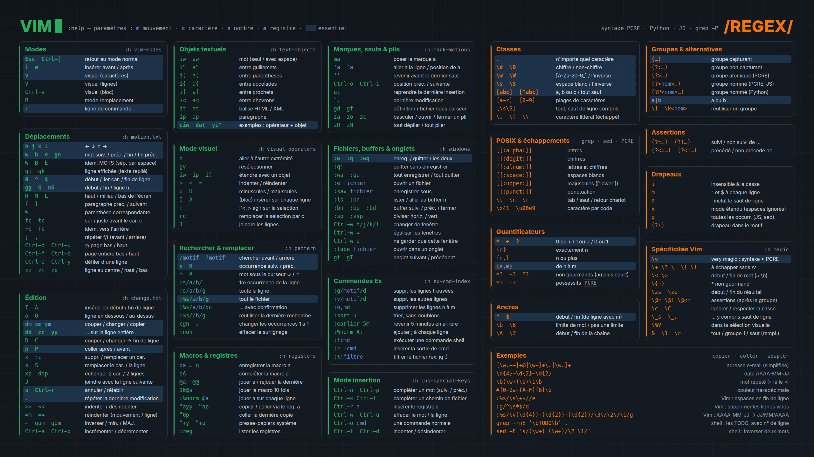

# Fonds d'écran aide-mémoire

Fonds d'écran « cheat sheet » générés en code (HTML → PNG via Playwright) :

- **Vim + Regex** : modes, déplacements, édition, objets textuels, macros… et regex PCRE/POSIX avec les spécificités Vim.
- **Git + Linux** : commandes Git courantes (préfixe `git` omis) et outils shell (grep, find, sed, awk, jq, systemctl…).
- **PowerShell + Windows** : cmdlets et alias PowerShell, cmd, outils Win+R, raccourcis clavier, WSL.
- **AS/400 (IBM i 7.4)** : commandes CL, navigation 5250, et Db2 for i (SQL, catalogue, services QSYS2).
- **Podman + virsh** : conteneurs, images, Containerfile, pods, Quadlet/systemd, et VM libvirt (cycle de vie, stockage, réseau, instantanés).
- **Python** : langage (types, chaînes, compréhensions, classes, typage, stdlib, asyncio) et outils (venv, pip, uv, pytest, ruff, pdb).
- **Rust** : langage (propriété, erreurs, itérateurs, traits, collections) et Cargo / rustup / crates courantes.
- **Node.js** : JavaScript moderne, API Node (fs, path, process, fetch), et npm / CLI node / tests intégrés.

Chacun existe :

- en **5 thèmes** : `aritim` (palette Plasma Aritim Dark), `dark`, `light`, `amoled` (noir pur, texte atténué
  contre le marquage) et `konsole`, généré depuis le jeu de couleurs Konsole (voir plus bas) ;
- en **3 formats** : paysage (2560×1440 et 3840×2160), portrait (1440×2560 et 2160×3840) et compact
  (1920×1080 : 4 colonnes, seulement les lignes essentielles et les premières de chaque panneau) ;
- en **2 langues** pour l'instant : anglais (`en`) et français (`fr`).

```
wallpapers/<langue>/<largeur>x<hauteur>/<fond-d'écran>-<thème>.png
wallpapers/fr/2560x1440/vim-regex-aritim.png
```



## Arborescence

```
.
├── src/
│   ├── content/             # un module par fond d'écran (textes en anglais)
│   │   ├── vim_regex.py
│   │   ├── git_linux.py
│   │   └── …
│   ├── wallpaper.py         # modèle, thèmes, gabarit HTML paysage / portrait
│   ├── i18n.py              # catalogues de traduction et outils (check, update, new)
│   ├── build.py             # écrit build/html/<langue>/<format>/*.html
│   ├── render.py            # HTML → PNG, détection des débordements
│   ├── konsole_theme.py     # thème depuis un .colorscheme Konsole → themes/<nom>.json
│   └── kde.py               # paquets Plasma, script KWin, commande cheatsheet
├── bin/cheatsheet           # change de sujet depuis un terminal
├── themes/konsole.json      # thème généré (make konsole-theme)
├── locales/
│   └── fr.json              # {"texte anglais": "traduction"}
├── wallpapers/              # PNG générés
├── build/html/              # pages HTML intermédiaires (généré, ignoré par git)
├── Makefile
└── requirements.txt
```

## Utilisation

```sh
make setup        # une fois : crée .venv et installe Playwright
make              # génère le HTML puis tous les PNG
make check        # vérifie seulement les débordements (quelques secondes)
make html         # HTML seulement (aperçu dans un navigateur)
make clean        # supprime build/
```

Chaque cible accepte une sélection (valeurs séparées par des virgules) :

```sh
make LOCALES=fr FORMATS=portrait,compact THEMES=konsole ONLY=rust,python
```

Le rendu utilise le Chrome/Chromium du système (ou `CHROME_PATH=/chemin/vers/chrome make`).
À défaut : `.venv/bin/python -m playwright install chromium`. `JOBS=8 make` règle le parallélisme.

`render.py` échoue si un texte déborde de son bloc ou entre dans la marge de sécurité du bas :
raccourcir le texte (dans la langue concernée) ou retirer une entrée.

## Modifier le contenu

Le contenu est dans `src/content/<fond_d_écran>.py`, **en anglais** (langue source).
Chaque panneau : `(titre, étiquette, largeur colonne commande en px ou None, lignes)`,
chaque ligne : `(commande, description)`.

| Syntaxe              | Effet                                                   |
|----------------------|---------------------------------------------------------|
| `"§cmd"`             | commande essentielle (surlignée, en gras)               |
| `«x»`                | paramètre (couleur secondaire ; traduit dès 2 lettres)  |
| `"⚠ desc"`           | commande destructive                                    |
| `"desc [GNU]"`       | badge de compatibilité en fin de ligne                  |
| `T("…")`             | étiquette ou titre de bandeau à traduire (sinon : code) |

Après une modification de texte : `make i18n-update` ajoute les nouveaux textes aux catalogues
(valeur vide = anglais affiché), puis les traduire dans `locales/*.json`. `make i18n-check`
liste ce qui manque.

En **paysage**, les colonnes sont celles du module ; en **portrait**, les deux zones sont empilées
et la zone de droite est redistribuée automatiquement sur 3 colonnes ; en **compact**, chaque zone
passe sur 2 colonnes et les lignes non essentielles (sans `§`) sont retirées en partant de la fin
des plus gros panneaux jusqu'à ce que tout tienne.

Thèmes : les couleurs de fond et de texte sont dans `BASE_THEMES` (`src/wallpaper.py`) ; chaque
fond d'écran n'ajoute que ses accents dans `ACCENTS` (`--a` zone gauche, `--b` zone droite, `--param`).

Thème **konsole** : `make konsole-theme` lit `KONSOLE_SCHEME` (par défaut
`~/.local/share/konsole/Aritim Dark.colorscheme`) et écrit `themes/konsole.json` : fond, texte et
sélection du terminal ; les accents de chaque fond d'écran sont pris dans la palette du terminal
(teinte la plus proche de ses accents « dark », éclaircie si besoin pour un contraste WCAG AA).
Tout fichier `themes/<nom>.json` devient un thème.

**Nouveau fond d'écran** : copier un module de `src/content/` (par ex. `git_linux.py`) et changer
le contenu, les accents et le `slug`. Il est détecté automatiquement ; `make i18n-update` ajoute
ses textes aux catalogues.

## Traductions

`locales/<code>.json` associe chaque texte anglais à sa traduction :

```json
{
  "search recursively": "chercher récursivement",
  "in place [GNU]": "en place [GNU]",
  "«file»": "«fichier»"
}
```

- Garder les badges `[…]` en fin de texte, le `⚠ ` en tête et les `{m}` des légendes.
- Les paramètres gardent leurs guillemets `«…»` dans la clé comme dans la traduction.
- Un même texte anglais a une seule traduction : si deux contextes demandent deux traductions
  différentes, écrire deux textes anglais différents.
- Les textes doivent tenir dans leur colonne : `make check LOCALES=<code>` le vérifie.

**Ajouter une langue** (ex. allemand) :

```sh
make i18n-new LOCALE=de      # crée locales/de.json avec tous les textes à traduire
# … remplir les valeurs (une valeur vide affiche l'anglais) …
make i18n-check              # avancement par langue
make LOCALES=de              # génère wallpapers/de/
```

## KDE Plasma

```sh
make install-kde                    # paquets + script KWin + commande cheatsheet
make install-kde KDE_LANG=en KDE_DARK=amoled KDE_LIGHT=light
make uninstall-kde
```

- **Paquets de fonds d'écran** : `~/.local/share/wallpapers/cheatsheet-<sujet>/`, un par sujet, avec
  toutes les tailles (Plasma prend celle de chaque écran : un écran 1920×1080 reçoit le format compact,
  un écran pivoté le portrait) et une variante claire (`KDE_LIGHT`) et sombre (`KDE_DARK`) choisie
  selon le jeu de couleurs. Ils apparaissent dans Configurer le bureau › Fond d'écran.
- **Raccourcis** (script KWin « cheatsheet », modifiables dans Configuration du système › Raccourcis › KWin) :

  | Raccourci | Sujet | Raccourci | Sujet |
  |---|---|---|---|
  | `Meta+Alt+V` | Vim · Regex | `Meta+Alt+O` | Podman · virsh |
  | `Meta+Alt+G` | Git · Linux | `Meta+Alt+Y` | Python |
  | `Meta+Alt+W` | PowerShell · Windows | `Meta+Alt+R` | Rust |
  | `Meta+Alt+A` | AS/400 | `Meta+Alt+N` | Node.js |
  | `Meta+Alt+PgDown` | sujet suivant | `Meta+Alt+PgUp` | sujet précédent |

- **Un sujet par bureau virtuel** (facultatif) :
  `kwriteconfig6 --file kwinrc --group Script-cheatsheet --key desktopTopics "1=git-linux,2=python"`
  puis `qdbus6 org.kde.KWin /KWin reconfigure`.
- **Terminal** : `cheatsheet list`, `cheatsheet rust`, `cheatsheet next 1` (écran 1 seulement),
  `cheatsheet current`.

## Polices

- Commandes : **MesloLGS Nerd Font** (repli : DejaVu Sans Mono).
- Titres et descriptions : **Inter** et Inter Display (repli : sans-serif du système, plus large :
  vérifier avec `make check` si la police change).
