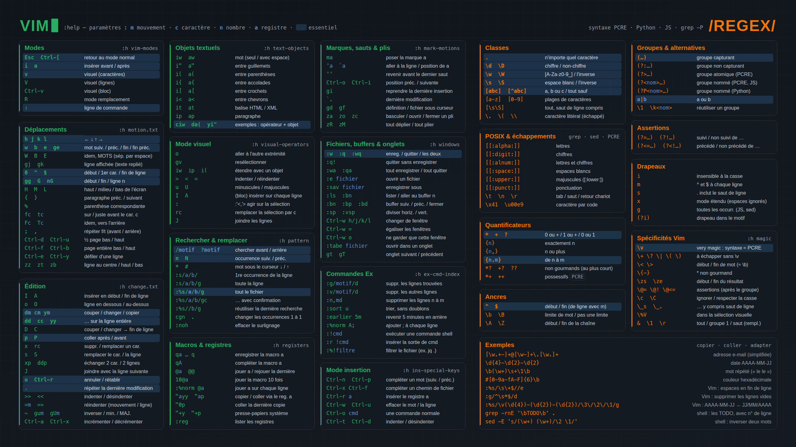

# Fonds d'écran aide-mémoire

Fonds d'écran « cheat sheet » générés en code (HTML → PNG via Playwright) :

- **Vim + Regex** : modes, déplacements, édition, objets textuels, macros… et regex PCRE/POSIX avec les spécificités Vim.
- **Git + Linux** : commandes Git courantes (préfixe `git` omis) et outils shell (grep, find, sed, awk, jq, systemctl…).

Chacun existe en 4 thèmes : `aritim` (palette Aritim Dark de Konsole), `dark`, `light`, `amoled` (noir pur, texte atténué contre le marquage).



## Arborescence

```
.
├── src/
│   ├── build_vim_regex.py   # contenu + mise en page Vim/Regex
│   ├── build_git_linux.py   # contenu + mise en page Git/Linux
│   ├── common.py            # rendu partagé (lignes, panneaux, badges)
│   └── render.py            # HTML → PNG 1440p et 4K, détection des débordements
├── wallpapers/
│   ├── 1440p/               # 2560×1440
│   └── 4k/                  # 3840×2160
├── build/html/              # pages HTML intermédiaires (généré, ignoré par git)
├── Makefile
└── requirements.txt
```

## Utilisation

```sh
make setup   # une fois : crée .venv et installe Playwright
make         # génère le HTML puis tous les PNG
make html    # HTML seulement (aperçu rapide dans un navigateur à 2560×1440)
make clean   # supprime build/
```

Le rendu utilise le Chrome/Chromium du système (ou `CHROME_PATH=/chemin/vers/chrome make`).
À défaut : `.venv/bin/python -m playwright install chromium`.

`render.py` échoue si un texte déborde de son bloc ou entre dans la marge de sécurité du bas :
après une modification du contenu, raccourcir la ligne ou retirer une entrée.

## Modifier le contenu

Les listes de commandes sont en tête de `src/build_vim_regex.py` et `src/build_git_linux.py`.
Chaque panneau : `(titre, étiquette, largeur colonne commande en px ou None, lignes)`.

Conventions dans les lignes (voir `src/common.py`) :

| Syntaxe              | Effet                                       |
|----------------------|---------------------------------------------|
| `"§cmd"`             | commande essentielle (surlignée, en gras)   |
| `«x»`                | paramètre (couleur secondaire)              |
| `"⚠ desc"`           | commande destructive                        |
| `"desc [GNU]"`       | badge de compatibilité en fin de ligne      |

Les thèmes sont des variables CSS dans le dictionnaire `THEMES` de chaque script.

## Polices

- Commandes : **MesloLGS Nerd Font** (repli : DejaVu Sans Mono).
- Titres et descriptions : Inter (repli : sans-serif du système).
